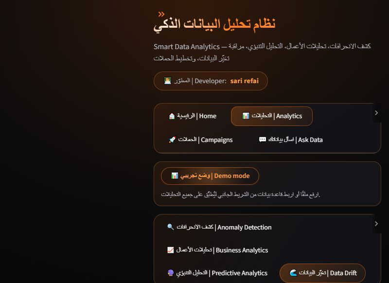

# نظام تحليل البيانات الذكي | Smart Data Analytics

[](https://www.python.org/)
[](https://streamlit.io/)
[](LICENSE)
[](https://github.com/YOUR_GITHUB_USERNAME/anomaly_detection_system/actions/workflows/ci.yml)
<!-- بعد إنشاء المستودع: استبدل YOUR_GITHUB_USERNAME باسم حسابك في GitHub -->

نظام تفاعلي مبني على **Streamlit** يجمع بين:
كشف الانحرافات، تحليلات الأعمال، التحليل التنبؤي المدعوم بالذكاء الاصطناعي،
**مراقبة تغيّر البيانات (Data Drift)**، تخطيط الحملات الإعلانية، ومحادثة مع البيانات
— مع تقارير PDF عربية وتصدير CSV/Markdown.

**المطوّر | Developer:** `sari refai`

---

## ✨ الميزات | Features

| التبويب | الوصف |
|---|---|
| 🔍 **كشف الانحرافات** | Isolation Forest · LOF · One-Class SVM مع ROC-AUC / PR-AUC، رسم PCA، توزيع الدرجات، وجدول أعلى الحالات الشاذة. |
| 📊 **تحليلات الأعمال** | اكتشاف تلقائي للأعمدة (تاريخ/إيراد/مصاريف/عميل/خدمة/حالة)، مؤشرات الإيراد والربح والهامش والتحصيل، تقييم صحة الأعمال، باريتو العملاء، تحليل شهري، وتقرير مالي ذكي (Markdown + PDF). |
| 🔮 **التحليل التنبؤي** | توقّع الإيراد/الربح/المصاريف، توقّع الطلب على الخدمات، توقّع خطر انخفاض الأرباح، توقّع سلوك العملاء (RFM + خطر الفقدان)، **Backtesting** (MAE/RMSE/MAPE/Bias)، و**محاكي What-if** للسعر/الكمية/المصاريف. |
| 🌊 **تغيّر البيانات (Drift)** | مقارنة البيانات الحالية بمرجع (تقسيم زمني / ملف مرجعي / لقطة محفوظة) عبر **PSI** و**KS** و**Chi²** و**Adversarial AUC**، مؤشر استقرار 0–100، خط زمني لتطوّر الانحراف، خريطة حرارية، توصيات عملية، وتصدير CSV/Markdown. |
| 🚀 **مخطط الحملات** | مدخلات الحملة (منصة/هدف/نطاق جغرافي/عمر/اهتمامات)، حاسبة حجم الجمهور (Potential Reach)، حاسبة الميزانية (CPM / CPC) بالدولار أو الدينار، والنتائج المتوقعة: ظهور، نقرات، تحويلات، CPA، وتوزيع ميزانية مقترح مع سيناريوهات متحفظ/متوقع/متفائل وتصدير Markdown/CSV. |
| 💬 **اسأل بياناتك** | محادثة عربية/إنجليزية تجيب بالأرقام من بياناتك، مع بديل محلي يعمل دون اتصال. |

**إضافات:**
- دعم **CSV / Excel / JSON** مع كشف الفاصل والترميز تلقائيًا.
- **ربط قواعد بيانات** (SQLite / PostgreSQL / MySQL-MariaDB / SQL Server / Oracle) واستخدام جدول أو استعلام قراءة فقط كمصدر بيانات.
- **تنقّل مبسّط:** لوحة رئيسية ببطاقات الخدمات + 4 أدوات، مع 4 تبويبات فرعية داخل التحليلات وانتقال مباشر من البطاقات.
- **مراقبة انحراف البيانات:** كشف مبكر لتغيّر التوزيعات قبل أن يؤثر على النماذج والقرارات، مع استبعاد تلقائي لأعمدة التواريخ والمعرّفات عالية التفرّد.
- **لوحة جودة البيانات**: مؤشر 0–100، نواقص، تكرارات، أرقام مخزّنة كنص، قيم سالبة، أعمدة فارغة/ثابتة.
- تحويل تلقائي للقيم مثل `"150 JOD"` وأسماء أعمدة عربية/إنجليزية.
- تخزين مؤقت (caching) للقراءة والتحليل لتسريع إعادة التشغيل.
- ثيم داكن أسود/برتقالي مع أنيميشنات، وواجهة ثنائية اللغة.

---

## 📸 لقطات الشاشة | Screenshots

| الصفحة الرئيسية | مراقبة تغيّر البيانات |
|---|---|
|  |  |

> الصور من التطبيق الفعلي على البيانات التجريبية المرفقة في `data/raw/`.

---

## 🚀 التشغيل | Run

```bash
# 1) إنشاء بيئة افتراضية (اختياري لكن مفضّل)
python -m venv .venv
# Windows
.venv\Scripts\activate
# Linux / macOS
source .venv/bin/activate

# 2) تثبيت المتطلبات
pip install -r requirements.txt

# 3) تشغيل التطبيق
streamlit run app/dashboard.py
```

ثم افتح `http://localhost:8501`.

> يتطلب Python 3.11+ (تم التطوير والاختبار على Python 3.14).

---

## ☁️ النشر | Deploy

### Streamlit Community Cloud (مجاني)

1. ارفع المشروع إلى GitHub (انظر خطوات النشر في نهاية هذا الملف).
2. افتح <https://share.streamlit.io> وسجّل الدخول بحساب GitHub.
3. **New app** ← اختر المستودع والفرع `main`.
4. **Main file path:** `app/dashboard.py`.
5. **Advanced settings → Python version:** اختر `3.12`.
6. (اختياري) **Secrets** — أضف مفتاح الذكاء الاصطناعي:
   ```toml
   AI_API_KEY = "your-key-here"
   ```
7. اضغط **Deploy**.

📘 دليل مفصّل (قائمة فحص قبل النشر، صيغة الأسرار الجاهزة، واختبارات ما بعد النشر):
[`docs/DEPLOY_STREAMLIT.md`](docs/DEPLOY_STREAMLIT.md)

> تُثبَّت الحزم تلقائيًا من `requirements.txt`. لا ترفع `.streamlit/secrets.toml`
> إلى المستودع أبدًا (مستثنى في `.gitignore`)؛ استخدم Secrets في المنصة.
> خط PDF العربي مرفق داخل `assets/fonts/` لذلك يعمل التصدير على Linux أيضًا.

---

## 🔑 إعداد الذكاء الاصطناعي (اختياري)

التقارير والمحادثة تعمل **بدون مفتاح** عبر محرك محلي احتياطي.
لتفعيل الإجابات المحسّنة، انسخ ملف المثال ثم ضع مفتاح الخدمة:

```bash
cp .streamlit/secrets.toml.example .streamlit/secrets.toml       # Linux / macOS
copy .streamlit\secrets.toml.example .streamlit\secrets.toml    # Windows
```

```toml
AI_API_KEY = "your-key-here"
```

> يُقبل أيضًا الاسم `GEMINI_API_KEY` للتوافق. الملف `secrets.toml` مستثنى في `.gitignore`.

أو عبر متغيّر بيئة:

```bash
set AI_API_KEY=your-key-here      # Windows
export AI_API_KEY=your-key-here   # Linux / macOS
```

يُقرأ المفتاح تلقائيًا من `.streamlit/secrets.toml` أو متغيّرات البيئة فقط، ولا يظهر في الواجهة.
في حال عدم توفّر المفتاح أو تعذّر الاتصال، يعرض النظام تقريرًا/إجابة محلية مبنية على أرقام البيانات.

---

## 🧭 طريقة الاستخدام | How to Use

1. اختر مصدر البيانات من الشريط الجانبي: **رفع ملف** أو **قاعدة بيانات (Database)**.
   - قاعدة البيانات: اختر المحرك، أدخل بيانات الاتصال، ثم حمّل جدولًا أو استعلام `SELECT`.
2. التنقل الرئيسي: **🏠 الرئيسية** (بطاقات الخدمات وملخص بياناتك) ← **📊 التحليلات** (4 تبويبات فرعية: انحرافات، أعمال، تنبؤي، تغيّر البيانات) ← **🚀 الحملات** ← **💬 اسأل بياناتك**. يمكنك الانتقال مباشرة من بطاقات الرئيسية.
3. المصدر نفسه يُطبَّق تلقائيًا على التحليلات والمحادثة؛ أما **🚀 الحملات** فتعمل باستقلال ولا تحتاج رفع بيانات.
4. يظهر أعلى قسم التحليلات شريط سياق يوضّح اسم المصدر ودرجة جودة البيانات وعدد الصفوف والأعمدة.
5. إعدادات الخوارزمية والسوق (العملة/الضريبة/الهامش/أفق التوقّع) موجودة داخل **⚙️ إعدادات متقدمة** ومطويّة افتراضيًا.
6. بدون تحديد مصدر يعمل النظام في **وضع تجريبي** ببيانات جاهزة.

> لا تُعرض مفاتيح الخدمة أو معرّفات النماذج في الواجهة أو التقارير.

---

## 🗂️ بنية المشروع | Project Structure

```
anomaly_detection_system/
├─ app/
│  ├─ dashboard.py             # نقطة الدخول: إعداد الصفحة + التنقل الرئيسي (≈120 سطرًا)
│  ├─ app_config.py            # المسارات، تسميات التنقل والتبويبات، أوضاع Drift
│  ├─ sidebar.py               # الشريط الجانبي: مصدر البيانات (ملف/قاعدة بيانات) والإعدادات
│  ├─ services.py              # خدمات البيانات المخزّنة مؤقتًا + توحيد مصدر البيانات
│  ├─ ui.py                    # عناصر واجهة مشتركة: CSS، KPI، تسميات الأقسام، جودة البيانات
│  ├─ charts.py                # كل رسوم Plotly (انحرافات/أعمال/تنبؤ/Drift)
│  ├─ detection.py             # المعالجة المسبقة وتدريب نماذج كشف الانحرافات
│  ├─ views/                   # تبويب لكل وحدة واجهة
│  │  ├─ home.py               # 🏠 الرئيسية + بطاقات الانتقال
│  │  ├─ anomaly.py            # 🔍 كشف الانحرافات
│  │  ├─ business.py           # 📈 تحليلات الأعمال + تقرير AI
│  │  ├─ predictive.py         # 🔮 التحليل التنبؤي (Backtesting + What-if)
│  │  ├─ drift.py              # 🌊 تغيّر البيانات (4 أوضاع مرجع)
│  │  ├─ campaigns.py          # 🚀 الحملات الإعلانية
│  │  └─ chat.py               # 💬 اسأل بياناتك
│  ├─ business_analytics.py    # محرك تحليلات الأعمال واكتشاف الأعمدة
│  ├─ predictive_analytics.py  # محرك التحليل التنبؤي والرؤى
│  ├─ drift_monitor.py         # كشف تغيّر البيانات (PSI / KS / Chi² / AUC)
│  ├─ forecasting.py           # Backtesting + محاكي What-if
│  ├─ chat_with_data.py        # محادثة البيانات + بديل محلي
│  ├─ data_loader.py           # قراءة CSV/Excel/JSON + جودة البيانات
│  ├─ db_connector.py          # ربط قواعد البيانات (قراءة فقط)
│  ├─ campaign_planner.py      # محرك تخطيط الحملات (جمهور/ميزانية/نتائج)
│  ├─ ai_report.py             # تكامل خدمة الذكاء الاصطناعي
│  ├─ pdf_export.py            # تصدير PDF عربي (RTL)
│  └─ assets/theme.css         # الثيم الأسود/البرتقالي
├─ assets/
│  └─ fonts/NotoNaskhArabic-Regular.ttf   # خط عربي مرفق لتقارير PDF (يعمل على Linux)
├─ data/
│  ├─ raw/                     # بيانات تجريبية
│  └─ processed/
├─ docs/
│  ├─ DEPLOY_STREAMLIT.md      # دليل النشر + الأسرار + استكشاف الأخطاء
│  └─ screenshots/             # صور README
├─ src/                        # محركات كشف الانحرافات (CLI)
├─ scripts/
├─ tests/                      # اختبارات الوحدة + الاختبار الدخاني للواجهة
├─ reports/                    # مخرجات التقارير
├─ .github/workflows/ci.yml    # فحص تلقائي (ruff + اختبارات)
├─ .gitattributes
├─ .gitignore
├─ LICENSE                     # MIT
├─ requirements.txt
├─ requirements-dev.txt        # أدوات التطوير (ruff + pytest)
├─ pyproject.toml              # إعدادات ruff
└─ README.md
```

### طبقات الكود | Code Layers

1. **المحركات** (`business_analytics`, `predictive_analytics`, `drift_monitor`, `forecasting`,
   `campaign_planner`, `data_loader`, `db_connector`, `ai_report`, `pdf_export`) — منطق خالص
   بلا Streamlit، قابل للاختبار مباشرة.
2. **الخدمات** (`services`) — تخزين مؤقت (`st.cache_data`) وتوحيد مصدر البيانات.
3. **العناصر المشتركة** (`ui`, `charts`, `app_config`) — بلا حالة.
4. **الواجهات** (`views/*`) — كل تبويب في ملف مستقل، و`dashboard.py` يوجّه فقط.


---

## 📄 مدخلات البيانات | Data Inputs

يتعامل النظام مع أي ملف جدولي تقريبًا دون إعداد مسبق:

- **CSV**: فواصل `,` `;` `Tab` `|` وترميزات UTF-8 / CP1256.
- **Excel**: `.xlsx` / `.xls`.
- **JSON**: قائمة سجلات أو كائن يحتوي `data` / `rows` / `records` / `items` / `results`.
- **قاعدة بيانات (Database)**: اختر المحرك ثم أدخل بيانات الاتصال. بعد الاتصال تختار جدولًا من القائمة أو تكتب استعلام `SELECT`، وتحدّد حد الصفوف، ثم **تحميل البيانات**. يُحوَّل الناتج إلى مصدر بيانات موحّد يُطبَّق على كل التحليلات.

### 🗄️ قواعد البيانات المدعومة

| المحرك | الحزمة | ملاحظات |
|---|---|---|
| SQLite | `sqlite3` (مدمج) | أدخل مسار ملف `.db` / `.sqlite`. |
| PostgreSQL | `psycopg[binary]` | Host + Port (5432) + Database + User + Password. |
| MySQL / MariaDB | `pymysql` | Host + Port (3306) + Database + User + Password. |
| SQL Server | `pyodbc` | يتطلب تثبيت **ODBC Driver 18 for SQL Server** على الجهاز. |
| Oracle | `oracledb` | Thin mode — لا يحتاج Instant Client. أدخل Service name. |

- الاستعلامات **قراءة فقط**: يُسمح بـ `SELECT` / `WITH` / `SHOW` / `EXPLAIN`، ويُمنع أي أمر تعديل (`INSERT`, `UPDATE`, `DELETE`, `DROP`, ...) أو أكثر من أمر واحد.
- كلمة المرور تُستخدم للاتصال فقط ولا تُعرض في الواجهة أو التقارير أو أسماء المصادر.
- إذا انقطع الاتصال تبقى البيانات المحمّلة متاحة، ويمكن إعادة الاتصال أو إزالتها من الشريط الجانبي.

أمثلة على أعمدة يُكتشفها تلقائيًا:
`date / التاريخ`, `total / amount / revenue / الإيراد`, `cost / expense / المصاريف`,
`client / customer / العميل`, `service / product / الخدمة`, `status / الحالة`.

---

## 🌊 مراقبة تغيّر البيانات | Data Drift

قسم داخل **📊 التحليلات** يكشف إن تغيّر توزيع بياناتك الجديدة عن التوزيع المرجعي (Baseline)
قبل أن يؤثر على النماذج والقرارات.

### 1) اختيار المرجع (ثلاث طرق)
| الطريقة | الوصف |
|---|---|
| 🕒 **تقسيم زمني** | يُرتَّب المصدر حسب عمود تاريخ، ثم يُستخدم أول X% (افتراضي 70%) مرجعًا والباقي هو «الحالي». القيم من 50% إلى 90%. |
| 📁 **ملف مرجعي** | ترفع ملفًا بنفس بنية البيانات (CSV/Excel/JSON) ويُقارَن بالمصدر الحالي. لا بد من وجود أعمدة مشتركة. |
| 📌 **لقطة محفوظة** | تحفظ البيانات الحالية في الجلسة (**Save baseline**) ثم تقارن بها أي مصدر لاحقًا، مع إمكانية التحديث أو المسح. |

### 2) المقاييس
- **PSI (Population Stability Index)** لكل عمود:
  - `< 0.10` → **مستقر** ✅
  - `0.10 – 0.25` → **مراقبة** 🟠
  - `> 0.25` → **انحراف** 🚨
- **KS Test** للأعمدة الرقمية و **Chi-square** للأعمدة الفئوية (مع `p-value`).
- **Adversarial Validation (AUC)**: نموذج يحاول التمييز بين المرجع والحالي؛
  `≈ 0.5` = توزيعات متشابهة، `> 0.70` = تغيّر هيكلي واضح.
  تُستخدم **طيّات تحقق مجمّعة** (`StratifiedGroupKFold`) تضع الصفوف المتطابقة في الطية نفسها،
  حتى لا ينقلب المؤشر عند مقارنة نفس البيانات بنفسها (يعطي `0.50` بدل قيمة مضلّلة).
- **مؤشر الاستقرار 0–100** = مزيج من متوسط PSI وأعلى PSI ونسبة الأعمدة المنحرفة.
- **إحصاءات مساندة:** تغيّر المتوسط، تغيّر نسبة القيم الناقصة، الفئات الجديدة، عدد القيم المميّزة.

### 3) الاستبعاد التلقائي
- أعمدة **التواريخ** لا تُحلَّل كأعمدة عادية (تُستخدم في الخط الزمني فقط).
- **المعرّفات عالية التفرّد** (`unique > 50` و `unique/rows > 0.6`) تُستبعد تلقائيًا،
  وتظهر مع بقية المستبعَدات في قائمة «أعمدة مستبعدة من التحليل» مع السبب.

### 4) المخرجات
- **KPIs**: الاستقرار · الأعمدة المنحرفة · أعلى PSI · Adversarial AUC + شارة حالة.
- **مؤشر PSI لكل عمود** (رسم أعمدة مع خطّي الحد 0.10 و 0.25).
- **مقارنة التوزيعات** للعمود المختار (Histogram رقمي / Bar فئوي: مرجع × حالي).
- **تطوّر الانحراف عبر الزمن**: خط لمتوسط/أقصى PSI لكل نافذة (يومي/أسبوعي/شهري/تلقائي)
  مع عمود عدد الصفوف، و**خريطة حرارية** (عمود × نافذة زمنية). تقلّل النوافذ الصغيرة عدد الفئات
  تلقائيًا، وتُعلَّم النوافذ التي تقل عن **20 صفًا** كنقاط مفرّغة لأن مؤشرها استرشادي فقط
  (ولا تُستخدم في حساب الاتجاه).
- **جدول تفصيلي** + **توصيات** مبنية على قواعد (تحقيق فوري، مراقبة مبكرة، فئات جديدة،
  تغيّر النواقص، إعادة تدريب، اتجاه تصاعدي).
- **تصدير**: CSV للتقرير الكامل و Markdown لملخص جاهز للصق.

---

## 🚀 مخطط الحملات الإعلانية | Campaign Planner

خدمة مستقلة في تبويب **🚀 الحملات** لا تحتاج رفع بيانات، وتتكون من ثلاث خطوات:

### 1) مدخلات الحملة
- **المنصة:** Instagram · Facebook · TikTok · LinkedIn · Snapchat · YouTube · Google Ads.
- **الهدف:** Awareness · Engagement · Clicks · Website Traffic · Conversions · Leads.
- **النطاق الجغرافي:** الأردن · إربد · عمّان · الزرقاء · العقبة · MENA · الخليج · عالمي.
- **الفئة العمرية:** من 13 إلى 65 سنة.
- **الاهتمامات والكلمات المفتاحية:** كل إضافة تضيّق الجمهور وتزيد دقة الاستهداف.

### 2) حاسبة الجمهور (Audience Estimator)
يحسب **الوصول المحتمل (Potential Reach)** عبر سلسلة خطوات شفافة:
السكان ← الجمهور الرقمي ← مستخدمو المنصة ← الفئة العمرية ← تضييق الاهتمامات والكلمات.

### 3) حاسبة التكلفة والميزانية (Budget & Pricing)
- إدخال الميزانية بالـ **JOD** أو **USD**.
- اختيار **CPM** أو **CPC** مع سعر مرجعي تلقائي لكل منصة (يمكن تعديله).
- النتائج المتوقعة: **الظهور · النقرات · التحويلات · CPA · متوسط التكرار**.
- رسوم: **قمع النتائج** و**توزيع الميزانية** (70% جمهور جديد / 20% إعادة استهداف / 10% اختبار إبداعي).
- **سيناريوهات** متحفظ / متوقع / متفائل + توصيات سريعة.
- تصدير الخطة كـ **Markdown** أو **CSV**.

> جميع الأرقام تقديرية مبنية على متوسطات السوق، وليست ضمانًا للنتائج الفعلية.

---

## 📊 التقارير | Reports

- **التقرير المالي الذكي:** Markdown + PDF.
- **التحليل التنبؤي:** Markdown + PDF.
- **نتائج كشف الانحرافات:** CSV كامل.
- **تقرير تغيّر البيانات:** CSV لكل الأعمدة + Markdown للملخص والتوصيات.
- **خطة الحملة:** Markdown + CSV.
- تصدير PDF عربي يدعم RTL مع تشكيل الحروف وعزل الأرقام.

---

## 🧪 الاختبارات والجودة | Tests & Quality

إعداد أدوات التطوير (مرة واحدة):

```bash
pip install -r requirements-dev.txt
```

| الأمر | ماذا يفحص |
|---|---|
| `python -m ruff check app src scripts tests` | قواعد الجودة والاستيرادات (ruff) |
| `python -m compileall -q app src scripts tests` | صياغة كل ملفات Python |
| `python tests/test_drift_unit.py` | **48** اختبار وحدة لمحرك Drift |
| `python tests/test_smoke_app.py` | اختبار دخاني فعلي: كل التبويبات + رفع ملف + SQLite |

نفس الاختبارات تعمل مع pytest:

```bash
pytest tests -q
```

الاختبار الدخاني يستخدم `streamlit.testing.v1.AppTest` ويفشل عند أي استثناء داخل
الواجهة. تفاصيل أكثر في [`tests/README.md`](tests/README.md)، وهذه الفحوصات تُشغَّل
تلقائيًا في GitHub Actions عبر [`.github/workflows/ci.yml`](.github/workflows/ci.yml).

لاختبار محرك Drift مباشرة:

```python
import sys
sys.path.append("app")
import pandas as pd
import drift_monitor as dm

df = pd.read_csv("data/raw/sales_sample.csv")
ref, cur = df.iloc[:400], df.iloc[400:]
report = dm.analyze_drift(ref, cur, bins=10)
print(report["summary"]["stability"], report["summary"]["level"])
```

---

## ⚠️ ملاحظات | Notes

- التوقعات تقديرية مبنية على الأنماط التاريخية، وقد تتأثر بعوامل خارجية.
- دقة التوقّع تُقاس فعليًا في قسم **Backtesting** (MAPE أقل = دقة أعلى).
- **مراقبة Drift تحتاج 20 صفًا على الأقل في كل مجموعة**، وتستبعد أعمدة التواريخ والمعرّفات عالية التفرّد تلقائيًا؛
  النوافذ الزمنية التي تقل عن **20 صفًا** تُعرض استرشادية فقط. اللقطة المحفوظة تبقى في الجلسة الحالية فقط (تُفقد عند إعادة تشغيل السيرفر).
- لا يتم إرسال بياناتك إلى أي خدمة خارجية إلا عند توليد تقرير ذكي أو طرح سؤال في المحادثة وبوجود مفتاح مُعدّ.

---

## 📤 النشر على GitHub | Publish to GitHub

```bash
# من مجلد المشروع
git init
git add .
git commit -m "Initial commit: Smart Data Analytics dashboard"
git branch -M main
git remote add origin https://github.com/YOUR_USERNAME/anomaly_detection_system.git
git push -u origin main
```

قبل الرفع تأكد من:

- أن `.streamlit/secrets.toml` و `.env` غير متتبَّعين: `git status --short`.
- استبدال `YOUR_GITHUB_USERNAME` في شارة CI أعلى هذا الملف.
- عدم وجود مفاتيح أو كلمات مرور داخل أي ملف مُتتبَّع.

---

## 📄 الترخيص | License

هذا المشروع مرخّص تحت رخصة **MIT** — انظر ملف [`LICENSE`](LICENSE).

## 👤 المطوّر | Author

**sari refai** — مشروع تخرّج في تحليل البيانات (Data Analytics).
